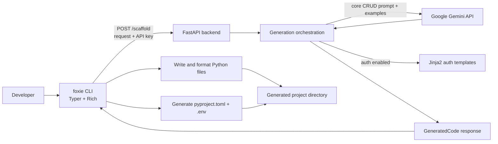

# 01 — Foxie Architecture and System Design

## Project in one sentence

Foxie is a Python-based scaffolding tool: a Typer CLI collects a FastAPI CRUD feature request, calls a FastAPI backend, and writes the generated application files to the user's machine.

## The main components

### `foxie-cli` — user-facing client

The CLI is installed as the `foxie` command. It handles interactive prompts and command-line options, resolves the user's Gemini API key, sends an HTTP request, validates the response shape with Pydantic models, writes files, and prints setup instructions.

### `foxie-backend` — generation API

The backend is a FastAPI application. It accepts a typed scaffold request, delegates to the generator, and returns generated files. The backend does not keep a user API key in application configuration: the CLI sends the key in each request, and the backend passes it to the Gemini client for that generation.

### Generation resources

- Gemini produces the core CRUD files.
- `.example` files provide conventions and reference code in the generation prompt.
- Jinja2 templates produce standardized authentication files when auth is enabled.
- The CLI generates the output project's dependency manifest and environment file from local templates.

### Runtime and packaging

The backend and CLI each have their own Python package configuration and Dockerfile. The root Docker Compose configuration can build and run the backend and CLI services together. The CLI can also be installed/run separately and configured to call a different backend URL.

## System context

## End-to-end request sequence

1. The developer runs `foxie scaffold fastapi-crud` with flags or answers the interactive prompts.
2. The CLI requires project name, resource, and a comma-separated field string. It applies SQL as the default database when no database is selected in command mode.
3. The CLI resolves `GOOGLE_API_KEY` from its environment or dotenv files; if missing, it asks for the key. It may offer to save it to `~/.config/foxie/config.env`.
4. The CLI sends JSON to the configured backend URL's `/scaffold` endpoint, with a timeout controlled by `FOXIE_SCAFFOLD_TIMEOUT`.
5. The backend validates the request against `ScaffoldRequest` and calls `generate_crud_feature()`.
6. The generator parses fields, validates the database selection, loads relevant example snippets, and asks Gemini for core CRUD files. If auth is enabled, it renders auth files from Jinja2 templates and merges auth route inclusion into the generated router.
7. FastAPI serializes the result as `GeneratedCode`, a list of `CodeFile` records.
8. The CLI writes code files to the project directory, strips Markdown code fences, attempts to run Black on Python files, and creates `pyproject.toml` and `.env` files.
9. The CLI prints next steps for installing dependencies and launching the generated FastAPI application.

## API boundary

Current backend routes are:

| Method | Path | Purpose |
|---|---|---|
| `POST` | `/scaffold` | Generate a CRUD scaffold; accepts project/resource/fields/database/auth/API key |
| `GET` | `/health` | Basic health response: `{"status": "ok"}` |

The response contract is `GeneratedCode { files: CodeFile[] }`. Each `CodeFile` contains `file_path`, `content`, and `description`. Keeping this contract explicit lets the backend evolve its generation internals while the CLI consumes a stable file bundle.

## Why this design

- **Separate user experience from generation:** the CLI can stay lightweight while the backend owns the LLM integration and generation logic.
- **Provider API key belongs to the user:** the CLI supplies a key per request instead of requiring a shared provider key in the backend deployment. This avoids centralizing provider usage, but means the key passes through the backend request and needs careful handling.
- **LLM plus deterministic templates:** flexible resource-specific CRUD is delegated to the model; standardized auth files and CLI config files are template-generated for repeatability.
- **Typed contracts:** Pydantic request/response models make the HTTP payload structure explicit.
- **Compose for local development:** services can communicate by the Compose service name; the CLI also supports a configurable backend URL for separately run deployments.

## Important engineering trade-offs and limitations

- The endpoint is declared `async`, but it calls a synchronous generation function. Gemini calls and retry sleeps can block the event loop; production concurrency would benefit from moving the work off the event loop or using a job/worker design.
- “RAG” here is example loading and prompt context, not a vector database or semantic retrieval pipeline. The loader selects files based on database/auth options and concatenates their contents.
- The server's health route only proves the FastAPI process responds. It does not prove Gemini credentials, quota, or generation health.
- The API key is part of the JSON request body. Use HTTPS for remote traffic, avoid request-body logging, and do not save or share keys carelessly. The CLI's global config file is plaintext unless the operating system protects the user's home directory.
- Generated output still needs validation and human review. Formatting with Black is not a syntax, security, or correctness test.
- Docker Compose currently passes a backend environment variable for `GOOGLE_API_KEY`, but the backend generator expects the request-provided key. Treat per-request key handling in the current implementation as authoritative.

## Source files to inspect

- Backend routes and request model: [main.py](../../foxie-backend/app/main.py)
- Generator and hybrid flow: [generator.py](../../foxie-backend/app/core/generator.py)
- Response models: [models.py](../../foxie-backend/app/core/models.py)
- Example-context loader: [rag.py](../../foxie-backend/app/utils/rag.py)
- Compose setup: [docker-compose.yml](../../docker-compose.yml)

## Interview practice

Be ready to draw the flow without notes and answer:

1. What responsibilities belong in the CLI versus the backend?
2. What is the API request/response contract?
3. What is deterministic and what is model-generated?
4. What would change if generation became a long-running, high-volume service?
5. How would you protect the API key and generated files?
